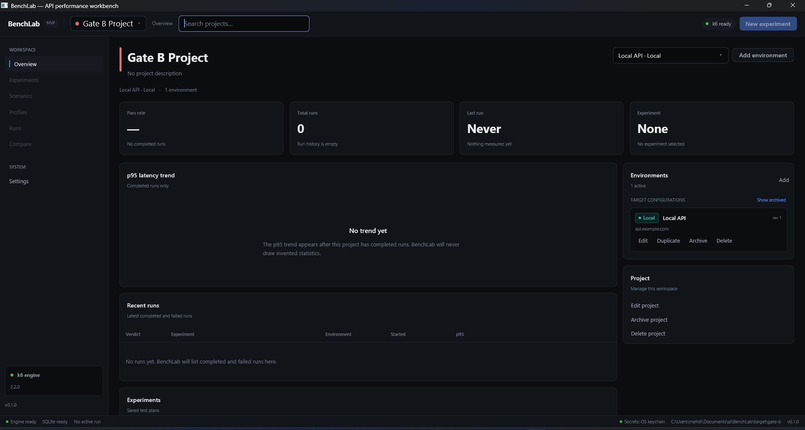
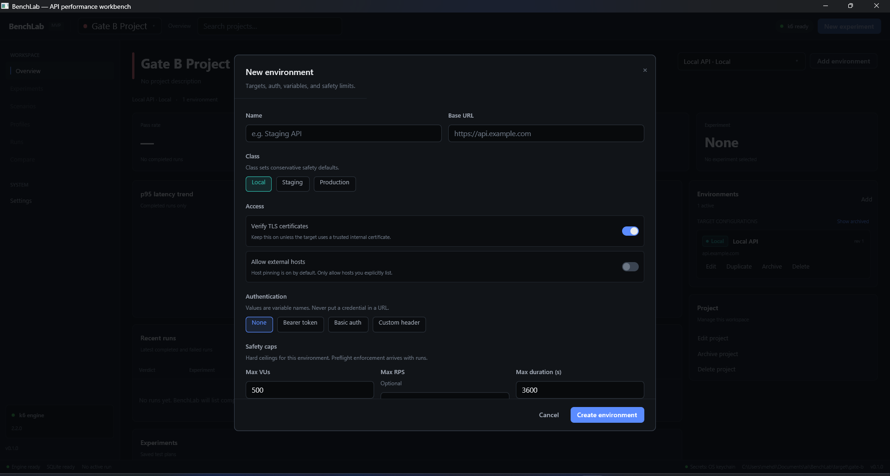

# M1 foundation report

Date: 2026-10-20
Status: **Gate B passed**

## Scope

M1 turns the M0 platform spike into a persistent application foundation:

- Dark instrument-panel theme and reusable components: Button, TextInput,
  Select, Table, Modal, Toast, Badge, Banner, empty state, and toggle/checkbox.
- SQLite schema and migrations, project/environment/settings repositories, and
  schema-version checks.
- Platform app paths, logging with seven-day cleanup, and a single-instance lock.
- Welcome screen, project switcher with filtering, project overview, navigation
  rail, top bar, settings, toasts, and status bar.
- Project CRUD: create, list, search, open, rename, archive, restore, and typed-name
  deletion.
- Environment CRUD: create, edit, duplicate, archive, restore, and delete, including
  variables, secret variables, auth modes, TLS, host pinning, and safety caps.
- Secret lifecycle through the OS keychain, with an explicit session-only
  fallback and a persistent UI indicator.
- k6 discovery status in the shell and status bar.

The detailed milestone list remains in `SPEC.md` §21. M1 intentionally does not
implement scenarios, experiments, runs, preflight, host-pinning enforcement, or
secret injection into k6; those arrive in later milestones.

## Gate B evidence

Gate B was exercised through the native Windows UI using a dedicated data
directory:

```powershell
$env:BENCHLAB_DATA_DIR = "C:\Users\mehdi\Documents\ai\BenchLab\target\gate-b"
target\debug\benchlab.exe
```

| Step | Result |
| --- | --- |
| First launch | Welcome screen opened and showed the engine strip (`k6 2.2.0 ready`) |
| Create project | Project **Gate B Project** created with the default accent |
| Create environment | Environment **Local API** created as `local` with base URL `https://api.example.com` |
| Restart | App was stopped and relaunched with the same data directory |
| Persistence | The project opened automatically and **Local API** was restored with revision 1 |
| Data directory | `benchlab.db`, `logs/`, `runs/`, and `benchlab.lock` were present |



The overview shows zero completed runs without inventing statistics: recent
runs are empty, the p95 chart has an empty state, and pass rate/last-run values
are placeholders. The selected environment and its class are visible in the
target selector and environment panel.

The environment editor was also opened and manually checked for fields, class
defaults, TLS/host controls, auth modes, and caps. Input validation blocks invalid
names, URLs, auth variable references, duplicate keys, missing secret values, and
out-of-range caps.



## Storage and secrets

SQLite lives at `<data_dir>/benchlab.db` and runs on `tokio-rusqlite`'s dedicated
thread. Public repository methods are async and are called from background tasks
by the app layer; the UI crate has no database dependency.

Secret values follow this split:

| Data | Location |
| --- | --- |
| Variable name and secret reference ID | SQLite |
| Secret value | OS keychain, service `dev.benchlab.app`, account `secret:<id>` |
| Secret values when keychain unavailable | Process memory only |

The app status bar and Settings show whether secrets are **OS keychain** or
**session only**. Saving a secret variable without a stored value is rejected;
duplicating an environment copies secret values to new keychain entries; deleting
an environment or project removes its keychain entries. Secret values are never
passed to the store, written to logs, or included in the database.

The app-level test `secrets_are_keychain_only_copied_and_deleted_with_the_environment`
saves a secret, scans every SQLite file including the WAL for the value, verifies
duplication, and verifies keychain cleanup after deletion. A separate Windows
keychain round-trip test runs when the credential store is available.

## Schema deviation

`environments.archived_at` is included in migration `0001_init.sql`. FR-ENV-01
requires archiving environments, but the schema sketch in SPEC.md §11.2 omitted
the column. Archived environments keep their data and are hidden from the default
list. This is the only deviation from the §11.2 sketch in M1.

## Verification

Run from the workspace root on Windows:

```powershell
cargo fmt --all -- --check
cargo clippy --workspace --all-targets -- -D warnings
cargo test --workspace
cargo build -p benchlab-app
```

All checks passed at the time of this report (`28` tests). The workspace test suite covers
domain validation, migrations, project/environment/settings repositories,
environment revision increments, archive/restore behavior, the single-instance
lock, session and Windows keychain secret stores, secret redaction from SQLite,
duplication, cleanup, and missing-secret rejection.

## Deliberate M1 boundaries

- The overview's run, experiment, and p95 sections are empty states until later
  milestones produce real runs. No mock metrics are shown.
- Production run authorization (typed environment name plus checkbox) belongs to
  the run preflight and is not exposed yet. Production/staging caps and the
  confirmation flag are already modeled.
- Test request (FR-ENV-12) and host-pinning enforcement are M2/M4 work; the
  configuration fields and validation are in place now.
- `Select` is mouse-driven in M1. Searchable/keyboard navigation and multiline
  editors are deferred to the scenario editor milestone.
- The UI test coverage is intentionally light in M1; Gate B was verified manually
  on Windows and the persistence/secret paths are covered by unit tests.
